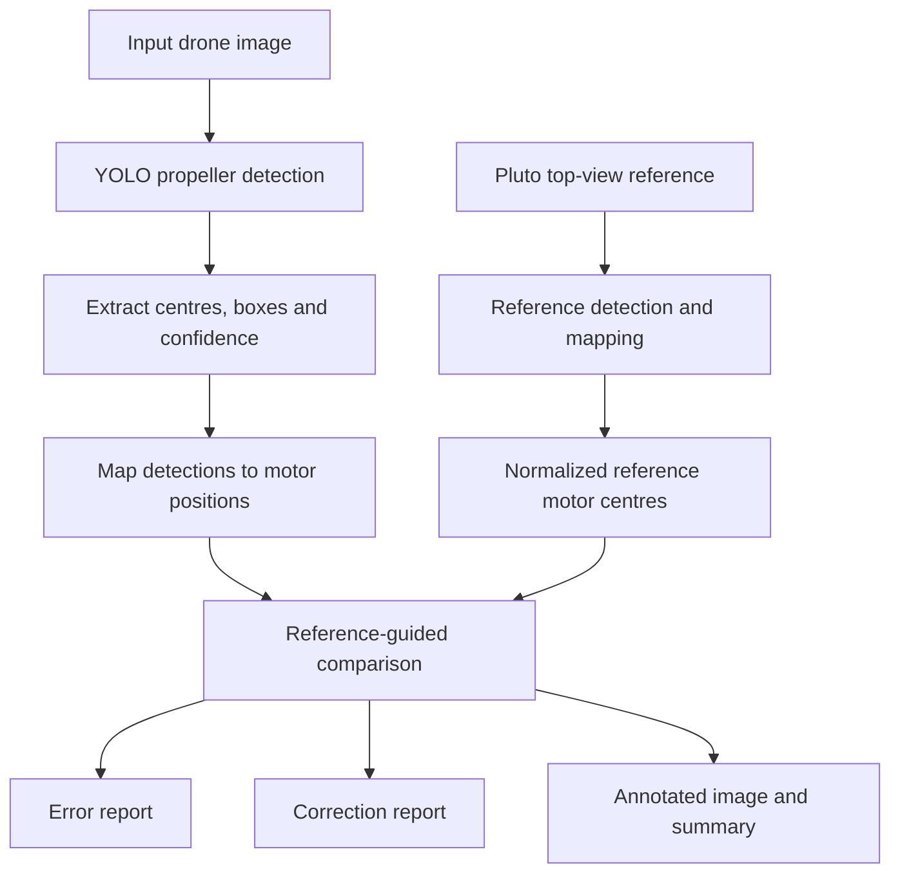

<h1 align="center">Pluto Drone Propeller Installation Verification</h1>

<p align="center">
  Computer vision and YOLO-based propeller detection for reference-guided inspection of a Pluto quadcopter.
</p>

---

## Overview

This project explores a computer-vision workflow for inspecting the propeller installation of a Pluto quadcopter from an image. A YOLO object-detection model identifies propeller regions, while a reference engine maps detected regions to the four expected motor positions: front-left (FL), front-right (FR), rear-left (RL), and rear-right (RR).

The pipeline generates an annotated image, a detailed error report, and a position-correction report. It is designed to fail safely: uncertain or incomplete evidence must not be presented as a verified installation.

**Current status:** experimental prototype. The supplied reference configuration is marked `ASSUMED`, not manufacturer-confirmed. Propeller type/orientation classification is not integrated into the final inference pipeline, so a successful motor-position mapping alone is not proof of correct installation.

## Project highlights

- YOLO-based detection of propeller regions in a Pluto drone image.
- Detection-centre extraction, bounding boxes, and confidence scores.
- Coordinate-based mapping of detections to FL / FR / RL / RR motor positions.
- Reference-image comparison using normalized motor-centre coordinates.
- Detailed error and correction reports in JSON format.
- Conservative verification status when detections or reference information are insufficient.

## System workflow



## Repository structure

```text
Pluto-Drone-Propeller-Verification/
├── assets/
│   └── images/              # Project visuals and Pluto reference image
├── docs/
│   └── diagrams/             # Mermaid workflow diagrams
├── models/
│   └── best.pt               # Supplied YOLO checkpoint
├── notebooks/
│   └── Pluto_Drone_Verification.ipynb
├── reference_engine/          # Coordinate mapping and reporting modules
├── scripts/
│   └── verify_image.py       # Command-line inference workflow
├── tests/
├── outputs/                  # Generated reports (not committed)
├── requirements.txt
└── README.md
```

## Setup

Python 3.10 or newer is recommended.

```bash
git clone <YOUR_REPOSITORY_URL>
cd Pluto-Drone-Propeller-Verification

python -m venv .venv
```

Activate the environment:

**Windows PowerShell**
```powershell
.venv\Scripts\Activate.ps1
```

**Linux / macOS**
```bash
source .venv/bin/activate
```

Install dependencies:

```bash
python -m pip install --upgrade pip
pip install -r requirements.txt
```

## Run verification

Place a suitable Pluto drone image on your machine, then run:

```bash
python scripts/verify_image.py path/to/drone_image.jpg
```

Optional arguments:

```bash
python scripts/verify_image.py path/to/drone_image.jpg \
  --weights models/best.pt \
  --reference assets/images/pluto_top_reference.png \
  --confidence 0.25 \
  --output outputs
```

The script writes the following files to the output directory:

| Output | Description |
|---|---|
| `annotated_input.jpg` | YOLO detections drawn on the input image |
| `detailed_error_report.json` | Detection, mapping, and configuration warnings |
| `correction_report.json` | Image-coordinate differences from the reference positions |
| `drone_verification_summary.json` | Combined run summary and report data |

Correction distances are image-space measurements in pixels. They are not physical measurements and should not be interpreted as direct instructions to move drone hardware.

## Run tests

```bash
python -m unittest discover -s tests -v
```

## Technology stack

- **Python** — project implementation
- **Ultralytics YOLO** — propeller object detection
- **OpenCV** — image loading, annotation, and processing
- **NumPy** — coordinate and geometry calculations
- **Jupyter Notebook** — experimentation and iterative development

## Verification logic and current limitations

The current implementation covers object detection, coordinate mapping, reference-centre comparison, and report generation. The following limitations remain:

1. The reference motor configuration is labelled `ASSUMED`; it has not been established as a manufacturer-verified configuration.
2. The final pipeline does not yet infer propeller type or clockwise / counter-clockwise orientation from image evidence.
3. The front direction is currently supplied as a fixed image direction (`[0, -1]`) and assumes a top-oriented input/reference view.
4. Reference-centre deviation is meaningful only when the input and reference images have compatible orientation and perspective.
5. The notebook contains exploratory and earlier implementation stages; use the command-line script as the organized entry point for the repository.
6. The supplied materials do not include a documented training dataset, class mapping, or model-training procedure. These should be added when available.

**Interpretation of results:** `MAPPING_SUCCESSFUL` means that the four detected regions were mapped geometrically. It does not mean that the propellers are correctly installed. The report keeps the overall result at `UNABLE TO VERIFY` while the reference configuration remains unconfirmed.

## Safety

Keep the drone disarmed and its motors stopped during image capture and inspection. This project is a software-based visual aid; it does not control the aircraft and is not a replacement for the manufacturer's pre-flight inspection procedure. Always verify propeller installation physically before flight.

## Model and asset notes

The YOLO checkpoint and project images are included as supplied project assets. Their original training-data provenance and separate licensing terms were not documented in the uploaded materials. Confirm that you have permission to redistribute the checkpoint and images before making the repository public. The MIT license in this repository applies to the project source code and documentation authored for this repository; it does not automatically relicense third-party model weights or imagery.

## License

Source code and repository documentation are released under the MIT License. See [LICENSE](LICENSE). Model weights and supplied images may be subject to separate terms as noted above.
