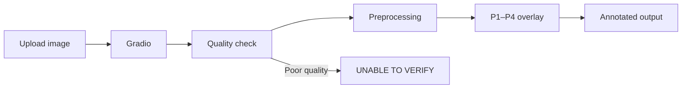
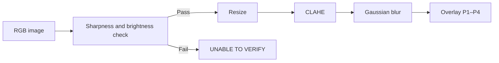
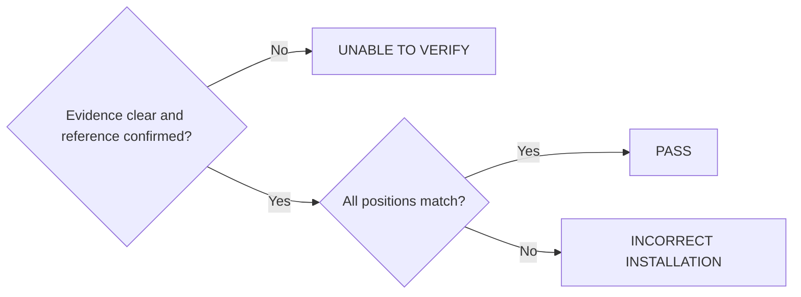

<p align="center">
  
</p>

> **A modular OpenCV-based computer-vision prototype for inspecting propeller installation on a Pluto quadcopter, using reference images, image preprocessing, annotated motor regions, and a Gradio interface.**

## 🔗 Live Website

**Check your drone's propellers here:** [https://pluto-propeller-verification-1.onrender.com/](https://pluto-propeller-verification-1.onrender.com/)

---

# Overview

<p align="center">
  
</p>

This project explores an image-based method for checking the propeller installation of a **Pluto quadcopter**. The application accepts a drone photograph, assesses basic image quality, preprocesses the image, and visualizes the four manually annotated propeller/motor regions against a Pluto reference image.

The system is developed in **Python** using **OpenCV**, **NumPy**, and **Gradio**. The architecture separates image preprocessing, reference annotations, detection, verification, and user-interface responsibilities, so each module can be developed, tested, and integrated independently by the team.

> **Current implementation status:** Image upload, image-quality assessment, preprocessing, reference-coordinate overlays, and the Gradio visualization have been exercised. The prototype does **not** yet reliably identify propeller type or installation orientation, and it does not automatically classify a drone as correctly or incorrectly assembled. Until the required detection and comparison logic is implemented and validated, the result remains **`UNABLE TO VERIFY`**.

---

# Problem Statement

Develop a software-based computer-vision system that inspects a Pluto drone image and determines whether its four propellers are installed at the correct motor positions and in the expected configuration.

The intended system should:

1. Accept a drone image through an upload interface.
2. Assess whether the image is suitable for inspection.
3. Locate the four motor and propeller regions.
4. Associate each region with a confirmed motor position.
5. Identify propeller type and orientation when sufficient visual evidence is available.
6. Compare the observed configuration with a verified Pluto reference configuration.
7. Highlight any affected motor positions and provide correction guidance.
8. Return one of three outcomes: `PASS`, `INCORRECT INSTALLATION`, or `UNABLE TO VERIFY`.

---

# Key Features

- Image upload through a Gradio interface
- Image-quality assessment using sharpness and brightness measurements
- Image resizing, contrast enhancement, and noise reduction using OpenCV
- Reference-based visualization of four manually annotated propeller regions (P1–P4)
- Display of the processed image and inspection status
- Conservative `UNABLE TO VERIFY` output when propeller type and orientation cannot be established

---

# Tools & Technologies

| Category | Technology |
|----------|------------|
| Programming Language | Python 3.12 |
| Computer Vision | OpenCV |
| Numerical Processing | NumPy |
| User Interface | Gradio |
| Data Handling | CSV / JSON |
| Development Environment | Visual Studio Code |
| Version Control | Git, GitHub |

---

# Inspection Flow

```
Upload Image
     │
     ▼
Quality Check (sharpness, brightness)
     │
     ▼
Preprocessing (resize, CLAHE, denoise)
     │
     ▼
P1–P4 Reference Overlay
     │
     ▼
Annotated Image + Status
```

---

# System Architecture

The current implementation uses reference annotations to draw the P1–P4 regions; it should not be interpreted as an automatic detector.



---

# Core Modules

| Module | Responsibility |
|--------|----------------|
| Gradio Application | Upload image; display annotated output and result |
| Preprocessing | Assess image quality and prepare image for inspection |
| Reference Annotations | Store P1–P4 motor points and propeller bounding regions |

---

# Image Processing Workflow

Image-quality thresholds are preliminary and should be evaluated against a broader set of clear, blurred, dark, overexposed, rotated, and partially occluded photographs before being treated as validated limits.



---

# Reference Dataset and Annotation

The initial dataset consists of five team-supplied Pluto drone photographs showing different views. The top-view photograph is used as the primary reference for the P1–P4 region annotations because it shows the four propeller assemblies in a relatively consistent layout.

| Parameter | Value |
|-----------|-------|
| Reference Images | 5 (multiple views) |
| Primary Reference | Top view |
| Region Identifiers | P1–P4 |
| Annotation Type | Manual motor points and bounding boxes |
| Annotation Formats | CSV / JSON |

Annotation files are intended to record the reference image name and view, image dimensions and quality notes, motor/propeller identifiers, motor-point coordinates, propeller-region bounding boxes, and any visibility limitations.

## Annotated Propeller Regions

<p align="center">
  
</p>

## Extracted Propeller Crop Preview

<p align="center">
  
</p>

> **Reference limitation:** P1–P4 are image-region identifiers, not confirmed `FL`, `FR`, `RL`, and `RR` physical motor labels. The drone's front direction and viewing convention must be confirmed before making that mapping. The expected clockwise / counter-clockwise configuration and propeller-type mapping must come from verified Pluto documentation or direct confirmed inspection; they must not be inferred from these photographs.

---

# Gradio Application

The interface accepts an image, displays the processed image with the reference regions, and reports the image-quality measurements. It deliberately does not claim a successful installation check when propeller type and orientation are not yet reliably determined.

<p align="center">
  
</p>

| Output Item | Current Behaviour |
|-------------|-------------------|
| Image Quality | Pass/fail using preliminary sharpness and brightness thresholds |
| Preprocessing | Resizes and enhances the uploaded image |
| Motor / Propeller Regions | Displays the four manually defined reference regions |
| Propeller Type | Not yet reliably classified |
| Installation Orientation | Not yet reliably classified |
| Final Decision | `UNABLE TO VERIFY` until the verification engine is validated |

---

# Verification Decision Logic

The intended decision policy is conservative: any uncertainty resolves to `UNABLE TO VERIFY`, never to `PASS`.



| Result | Meaning | Application Response |
|--------|---------|----------------------|
| `PASS` | All required positions match the verified Pluto configuration with sufficient confidence | Display the pass result and supporting inspection information |
| `INCORRECT INSTALLATION` | A reliable comparison identifies a mismatch | Highlight the affected position and provide grounded correction guidance |
| `UNABLE TO VERIFY` | Image, detections, motor mapping, or reference configuration is incomplete or ambiguous | Explain why a decision cannot be made |

---

# Installation and Execution

**1. Clone the repository**

```bash
git clone <YOUR_GITHUB_REPOSITORY_URL>
cd Pluto_Propeller_Verification
```

**2. Create and activate a virtual environment (Windows PowerShell)**

```powershell
py -3.12 -m venv .venv
.venv\Scripts\Activate.ps1
```

**3. Install dependencies**

```powershell
python -m pip install --upgrade pip
python -m pip install opencv-python numpy gradio pandas
```

Or, if a maintained `requirements.txt` is present:

```powershell
python -m pip install -r requirements.txt
```

**4. Run the application**

```powershell
python app/app.py
```

Open the local Gradio URL printed in the terminal. The port may vary if the default is already in use.

---

# Project Structure

```
Pluto_Propeller_Verification
│
├── app
│   └── app.py
│
├── annotations
│   ├── reference_config.json
│   ├── ground_truth.csv
│   ├── image_metadata.csv
│   ├── motor_positions.csv
│   └── propeller_regions.csv
│
├── dataset
│   ├── reference
│   ├── correct
│   ├── incorrect
│   └── unclear
│
├── detection
│   ├── motor_detection.py
│   └── propeller_classification.py
│
├── preprocessing
│   └── preprocessing.py
│
├── verification
│   └── verification.py
│
├── tests
│   └── test_cases.py
│
├── docs
│   └── diagrams
│
├── assets
│   └── images
│
├── main.py
├── requirements.txt
├── README.md
└── LICENSE
```

Some folders and files may still be placeholders while the team workstreams are being integrated.

---

# Testing & Validation Status

- [x] Load and inspect the five supplied reference photographs
- [x] Generate manual motor points and propeller regions for the top view
- [x] Run image-quality assessment on the reference image
- [x] Run preprocessing and inspect the processed output
- [x] Launch the Gradio interface and visualize the reference regions

---

# Limitations

- The prototype uses manually annotated reference coordinates; it is not yet a general-purpose automatic detector.
- Five photographs are not a sufficiently varied dataset for training or validating a robust classifier.
- The physical front direction and FL/FR/RL/RR mapping cannot be established from the available photographs alone.
- Propeller type and CW/CCW orientation cannot be reliably inferred from the current visual evidence.
- Image-quality thresholds are preliminary and require broader validation.
- A displayed bounding box only identifies an image region; it does not prove correct installation.

---

# Safety

Keep the drone disarmed and its motors stopped during image capture and inspection. This project is a software-based visual aid and does not control the aircraft. It is not a replacement for the manufacturer's pre-flight inspection procedure. A `PASS` outcome should only be enabled after the reference configuration and the full detection and verification pipeline have been validated.

---

# Team Contributions

| Member | Workstream | Main Responsibility |
|--------|------------|---------------------|
| Member 1 | Detection | Image processing support and automatic motor/propeller localization |
| Member 2 | Dataset & Reference | Reference images, annotations, metadata, and confirmed reference mapping |
| Member 3 | Verification | Compare detected propellers with the verified reference and classify defects |
| Member 4 | Application & Integration | Gradio interface, module integration, reporting, and end-to-end testing |

---

# License

This project is licensed under the **MIT License**.
